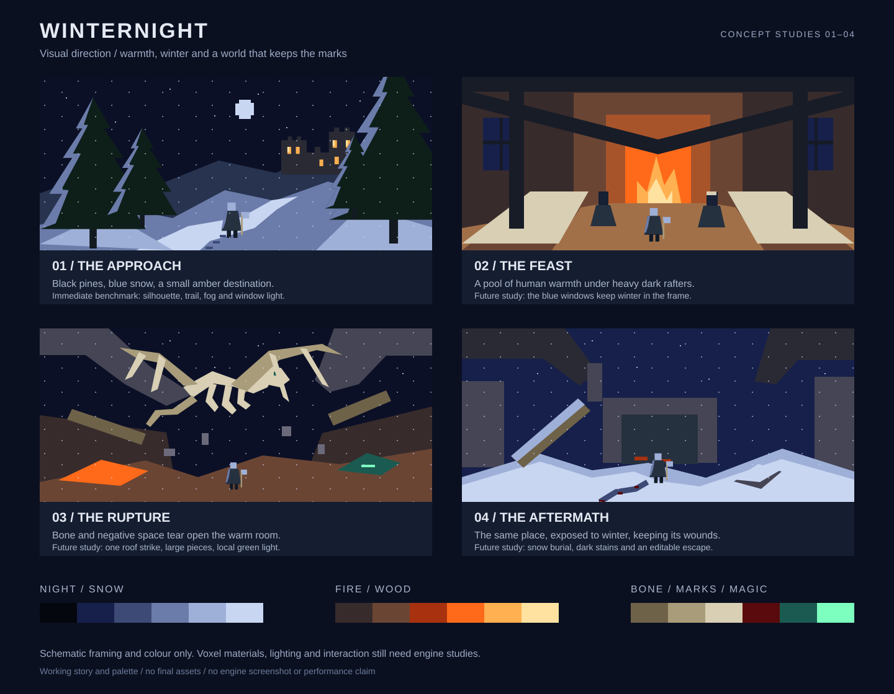

# Winternight — Visual Style Guide

> Art direction, not a screenshot specification. The prototype is the starting
> point; the studies below describe the intended finish. All palette values and
> proportions are working defaults. See [engine concept](voxel-engine.md) for
> feasibility and [validation plan](validation-plan.md) for evidence.

## The image to protect

Black pines enclose a winding strip of blue-white snow. A small warrior moves
through its lower third. Across the clearing, a castle is almost lost in the
night except for a handful of amber windows. Snow catches the moon in small,
sharp planes; the foreground keeps enough shadow to feel cold.

The closest reference is late-1990s 3D composition with visibly voxel-built
materials: broad shapes, short colour ramps, crisp silhouettes and restrained
noise. Keep clean, stable geometry as the default. Vertex wobble is an optional
flat-screen effect, not the foundation of the look.

[Open the composition board](boards/winter-night.svg). These are schematic
colour and framing studies, not generated engine frames, final assets or a
promise of current rendering quality. They intentionally simplify materials.

## Four visual studies

| Study | Composition and value | Colour and motion | What should stay in memory |
|-------|-----------------------|-------------------|----------------------------|
| Approach | Two dark tree masses frame an S-shaped road. Castle near the upper-right third; warrior below centre. Separate foreground, forest and fortress in three values. | Mostly blue / indigo. Amber occupies only a small part of the image. Sparse slow flakes. | A warm place far away. |
| Feast | Low tables lead toward a hearth and the mage. Tall dark rafters leave space above human heads. Snow-blue windows stay visible at the sides. | Amber and warm wood dominate. Flame movement is local, not a whole-screen pulse. | Brief human warmth surrounded by winter. |
| Rupture | A roof opening creates a new diagonal. The bone dragon's ribs and wing spars cut across it; figures below establish scale. | Bone ivory separates from black sky. Pale green enters locally as firelight weakens. | Warmth being torn open. |
| Aftermath | Reuse part of the feast or approach framing. A broken beam and a half-covered trail replace the former welcome. | Return to blue, with tiny ember patches and restrained dark red. | The same place has changed and remembers it. |

The last three are future scene studies. The forest is the immediate benchmark.

## Darkness that remains playable

Use a simple value hierarchy before adding colour:

- Sky and deep pine interiors are darkest. Their silhouettes must remain distinct
  from the slightly lighter distant fog.
- Walkable snow is a middle value in shadow, with a narrow pale moonlit edge.
  Reserve its brightest ramp for exposed ridges, not the whole ground.
- The warrior's cloak is dark against snow, while helmet, shoulder and blade
  catch a small cold rim. Do not outline every edge.
- Firelit windows are the brightest destination. Preserve their shape instead
  of letting glow consume the wall.

Judge the benchmark in greyscale and at its actual 480×270 internal resolution.
The player should find the road, warrior and castle without a marker. Test both
pale and dark displays later; an exposure slider can help, but cannot repair
missing silhouette separation. Keep local detail around the feet readable.

No exterior torches or floating fill lights are needed on the opening road.
Moonlight supplies direction; a modest sky ambient term preserves form. Warm
spill appears only near a real castle opening or another authored fire source.
Stars contribute to the sky impression, not individual scene lights.

## Shape language and scale

- **Forest:** long vertical trunks and stepped, asymmetric branch tiers. Break
  uniform spacing; avoid repeated identical conical trees along a corridor.
- **Snow:** large calm drifts with occasional angular ridges. Fine noise should
  never turn every white surface into a checkerboard.
- **Castle:** heavy buttresses, a few recognizable towers and small windows.
  Model large forms before masonry decoration. The wall must feel thick when cut.
- **Warrior:** broad shoulder triangle, distinct helmet and cloak, compact weapon
  silhouette. Test recognition at roughly 25–40 screen pixels tall, depending on
  distance and camera, rather than relying on facial detail.
- **Dragon:** a readable skull, open rib cage and long wing spars. Negative space
  between bones conveys size more cheaply than a solid body of tiny detail.
  Propose a 20–30 m wingspan for a silhouette study before committing geometry.

At the provisional 10 cm world cell the 1.8 m warrior is about 18 voxels tall.
That is enough for a silhouette study, not a guarantee of expressive faces or
thin blades. Compare 5 cm, thicker stylized props and separate model detail
before choosing production scale. Keep all dimensions in metres in scene design.

## Material treatments

| Surface | Large read | Close interaction read | Avoid |
|---------|------------|------------------------|-------|
| Fresh snow | Calm blue-white planes; darker sheltered underside. | Lowered fill, footprint wall, small compacted patch and a brief puff. | Perfect repeated circles or dense glitter. |
| Packed snow | Cooler, darker and slightly flatter than untouched powder. | Scuffed route and shallow impressions. | A texture that looks like bare stone. |
| Pine bark / cut wood | Almost-black trunk with a thin moon-facing edge. | Fresh cut exposes a warm muted core and coarse splinters. | Bright green trees at night. |
| Stone | Broad blue-grey masses, deeper seams and chipped edges. | A cut reveals volume with the same material rules. | Brick patterns that imply separate immutable geometry. |
| Ice | Opaque blue base, pale fracture edges and sparse highlights. | Chips and a clear rim around a broken section. | Expensive transparency and unreadable collision. |
| Bone | Warm ivory in moonlight, dark cavities and occasional old stains. | Missing segments, chunky chips and powder. | Pure white shapes merging with snow. |
| Blood | Small dark-red interruptions in pale snow. | Red centre, weaker seepage, then a darker age ramp. | Large luminous red decals or unbounded liquid. |
| Fire / windows | Tiny hot centre and short amber halo. | Light falls on nearby snow and the inside of a broken opening. | Glow leaking through intact walls. |

## Working palette

The final flat-screen image uses a 64-colour master palette. These are reference
swatches, not an exhaustive replacement for `game/data/palette.txt`.

| Use | Swatches |
|-----|----------|
| Sky / distance | `#05070f` `#0b1026` `#16204a` |
| Snow | `#c9d6f2` `#9fb0d8` `#6b7cab` `#3d4a75` |
| Pine | `#0e1f1a` `#173328` `#24493a` |
| Castle | `#2a2a35` `#454555` `#6a6a7a` |
| Fire | `#ffe2a0` `#ffb050` `#ff6a1a` `#a83210` |
| Blood | `#5a0a0c` `#8c1016` `#c21e22` |
| Bone | `#d8cfb4` `#a99c7a` `#6e6249` |
| Necromancy | `#1a5a50` `#7dffc0` `#2affb0` |

Keep necromantic green scarce until the seizure. Cold blue, pale bone and warm
fire should already describe the world without it. Blood and the path must also
read through shape and value when colour perception varies.

## Rendering rules

| Element | Working rule |
|---------|--------------|
| Flat-screen target | 480×270 by default; 320×180 for a lower tier and 640×360 for a higher tier. Nearest-neighbour integer upscale and letterboxing. |
| Surface shading | Simple diffuse light, voxel ambient occlusion and short material ramps. Use restrained glints for ice / snow as a later experiment. |
| Colour variation | Stable world-position hash, with low amplitude on snow. Shader variation preserves large merged faces. |
| Palette / dither | Optional 64-colour mapping and 4×4 ordered dither. Keep bands deliberate; avoid strong crawling noise under camera motion. |
| Moon | One blue-white directional light near `#9fb4e0`; crisp, stable low-resolution shadows. |
| Fire | Warm emitters from `#ffb050` to `#ff6a1a`, bounded spread through open voxel space. |
| Fog | Blue distance separation that hides streaming transitions while allowing the castle's window pattern to survive. |
| Glow | Small low-resolution halo with a visible emissive core. |
| Sky | Stable world-oriented stars and a modest moon. Aurora is a later scene option. |
| Retro snapping | Optional on flat screens; always disabled in XR. |
| UI | Sparse readable text, minimal crosshair if needed, large touch actions outside the central composition. |

## Snow and blood in motion

Snow has three scales: large static drifts, persistent compressed tracks, and
short-lived powder / falling flakes. The terrain carries most of the image;
particles decorate it. A foot lowers real snow fill, leaving a darker sidewall
that reads even when particle density is reduced. Branch snow should drop in
clumps before dissolving into finer powder.

A strike sends a few visible droplets along its direction. On impact they stain
the receiving voxels; in snow, a smaller dark halo spreads locally. Heavy
bleeding can form a bounded shallow pool. Freeze and ageing change colour and
flow, while fresh accumulation hides the old stain beneath the new surface.
Do not use reflection-heavy fluid shading. Full, Reduced and Off gore settings
must preserve the scene's composition and navigational clues.

## Deformation should improve the image

A cut needs an exposed interior, a clear missing volume, a few characteristic
fragments and a settled result. Keep dust brief enough to see what changed.
Snow on a falling tree stays attached until released or deposited; a demolished
window changes the nearby light; roof damage admits weather. Those combined
responses are more valuable than thousands of independent fragments.

The bone dragon is the eventual scale test. Start with its silhouette crossing
the moonlit opening and one bounded roof strike. Preserve big structural pieces
and readable pauses between impacts. Unrestricted full-castle physics is not a
prerequisite for that shot.

## Mobile and XR presentation

On phones, review with the actual touch overlay and safe-area insets. A camera
that looks good with a mouse can hide the route behind a thumb. Lower distant
rings, decorative flakes and glow before removing the nearby trail.

In XR, retain voxel shapes, colour ramps and fog, but evaluate eye resolution
against readability at headset refresh rate. Do not force a 480×270 image over
each eye. Disable snapping, forced shake and head bob. Treat screen-space
dithering as a comfort risk: prefer stable surface variation, and evaluate an
XR-specific dither option separately. The old foundation design suggests a
50% eye scale and blue noise; neither is a hardware-validated quality setting.

## Visual review checklist

- Can the route, warrior and destination be identified at internal resolution?
- Does the castle remain inviting when glow is reduced?
- Do the intact and cut versions of a pine or wall share one material language?
- Do footprints read from the gameplay camera after their puffs disappear?
- Does blood seep into snow rather than float above it, and does fresh snow bury it?
- Does a second visit show the player's changes without stale distant scenery?
- Does the image remain coherent with gore Off and fewer decorative particles?
- Does XR preserve scale and comfort while the flat-screen view preserves pixels?

Automated image comparisons protect an approved look; they cannot choose the
look. Use this checklist for human review before accepting new golden images.
