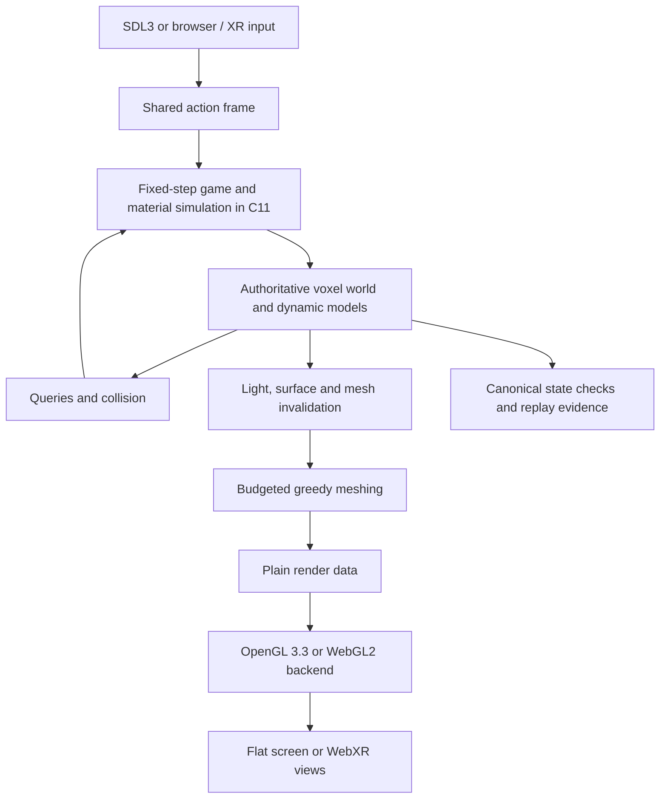

# Winternight — Voxel Engine Concept

> Technical direction, grounded in the current prototype. **Existing** means code
> is present, not that production performance or every edge case is validated.
> **Proposed** means future work requiring a scoped OpenSpec change. This pass
> changes no runtime code. The foundation decisions and requirements remain in
> [the original change](../../openspec/changes/establish-winternight-concept/).

## What the engine is for

Build a small, authored winter world whose physical materials can be changed at
voxel resolution. A boot, axe, falling beam and dragon impact should use the same
world state. Snow, stains, collision, lighting and meshes must agree about the
result. The engine serves that image; it does not need to become a general
simulation platform.

Use **C11 for engine and game**, **SDL3 for the application layer**, and a
**rasterized OpenGL 3.3 / WebGL2 renderer**. OpenGL is useful because visible voxel
faces can become ordinary triangle meshes; a voxel engine does not require a
special GPU API. Emscripten compiles the shared C core to WebAssembly. A small
JavaScript bridge handles browser-only functions, including WebXR.

## Why this representation

| Approach | Advantage | Cost for this game | Direction |
|----------|-----------|--------------------|-----------|
| Chunked cells + greedy surface meshes | Straightforward edits, material queries, fill heights and portable raster rendering. | Local remeshing and memory need budgets. | Keep as the baseline. |
| Sparse voxel octree + ray traversal | Excellent compression for some large sparse scenes; direct voxel rendering. | Dynamic topology, traversal and mobile WebGL2 performance add complexity. | Reconsider only if measured needs justify it. |
| Smooth density field / marching cubes | Rounded organic terrain. | Rebuilds, material boundaries and a different visual language. | Outside the current blocky direction. |
| Fixed polygon scenery + surface decals | Quick static scenes and cheap marks. | Deep cuts, rubble and snow volume no longer share one physical model. | Useful only for explicitly decorative elements. |

This choice fits phones and WebXR without compute shaders, geometry shaders,
SSBOs, GPU readback for collision, or a second engine written in JavaScript.

## The deformation contract

"Everything deformable" applies to physical terrain, snow, trees, walls, props,
creatures and their detached pieces. The sky, fog and decorative particles are
rendering effects. Invisible lower-world anchors provide bounded structural
support. A distant mesh is a cached view of editable content, not a separate
indestructible castle.

It does **not** imply infinite edit resolution, unlimited moving fragments,
elastic cloth, accurate fracture mechanics or continuous simulation everywhere.
Damage changes a cell's state; removing cells changes topology; disconnected
pieces can become small voxel rigid bodies. Bending and stretching are not the
current model. All materials can respond, while hardness determines the effort.

**Proposed rules for a production slice:**

- Query and mutate authoritative cells in a fixed simulation step. Collision
  changes with the cells, even if a replacement mesh is still queued.
- A near-field cut or doorway must become visible promptly. Keep edits bounded
  enough that delayed meshes cannot hide a dangerous new hole.
- A structural search hitting its work limit treats the structure as supported,
  matching the current conservative approach. Do not guess a giant collapse.
- Mark the affected chunk and neighbouring mesh borders dirty. When workers
  eventually exist, reject results whose source revisions have changed.
- Saturation must preserve traversable, gameplay-relevant pieces. Reducing
  decorative fragments must not remove the beam holding up the player.
- Rebuild distant proxies from changed content or invalidate their affected
  regions. Walking away must not restore a demolished silhouette.

These rules need dedicated tests before claiming unrestricted castle destruction.
Mobile must get the same collision outcome as desktop; XR additionally needs
cuts visible at arm's length without a distracting update backlog.

## Architecture and edit flow

`engine/` and `game/` form `wn_core`, with no SDL, GL or browser headers. They
own materials, edits, movement, simulation, meshing and render planning.
`platform/` owns windows, timing, GPU objects and web / XR integration. This
already exists and makes a GPU-free unit build possible. Canonical replay
evidence in the diagram is the target; see the checksum limitation below.

Keep fixed-step work deterministic by counting cells or operations and keeping
stable queue order. Frame-time budgets can control presentation work, such as
meshing, without deciding which gameplay edits occur. Cosmetic particles get a
separate random stream; droplets that stain and clumps that deposit snow belong
to simulation state. Threads are an optional optimization, not a browser
requirement.

## Cells, chunks and scale

The existing world uses 32×32×32 chunks and one 32-bit word per expanded cell:

| Bits | Existing field | Consequence |
|------|----------------|-------------|
| 0–7 | Material ID; 0 is air. | Up to 256 materials. |
| 8–11 | Fill height. | Values 1–15 represent sixteenths; **0 means full height for an occupied cell**, not empty. |
| 12–15 | Quantized accumulated damage. | Cheap localized damage rather than floating health per cell. |
| 16–17 | Stain type. | Current types are none, fresh blood, dried blood and ichor. |
| 18–23 | Stain amount. | 64 intensity levels. |
| 24–27 / 28–31 | Sky / block light. | Small light levels; hue is supplied separately by rendering. |

Occupancy comes from material and material kind, never from testing fill == 0.
At 10 cm, a chunk spans 3.2 m and one fill increment is 6.25 mm. At 5 cm, it
spans 1.6 m. Halving cell size costs roughly **eight times as many cells for the
same fully populated world volume**; surface and edit costs also increase.
Keeping a chunk radius unchanged would instead halve the visible world span.

A dense chunk is exactly 128 KiB of cell words before metadata, meshes, light
queues or allocator overhead. Uniform chunks store one value. For a square
radius of five chunks and 16 vertical chunks, 11×11×16 = 1,936 dense chunks
would already cost **242 MiB** just for cells. The prototype relies on uniform
air / solid chunks and lower-detail meshes; those are savings to measure, not a
guaranteed memory bound. Lighting variation can also expand a uniform chunk.

**Scale decision:** keep the existing configurable `WN_VOXEL_SIZE`, default
0.1 m. Review identical shots at 0.1 m and 0.05 m, including character hands,
weapon thickness, footprints and measured memory. Do not silently choose finer
cells for the whole world to fix one character silhouette. Per-model detail is
a later option needing consistent collision and damage mapping.

## Deformation and moving pieces

The prototype already provides material hardness, sphere / box / capsule edits,
connectivity checks, voxel debris and bone-attached models. A good production
pipeline is:

1. Collect a bounded weapon or impact volume; apply damage in a stable order.
2. Write cells, increment revisions and queue local light changes.
3. Search neighbouring solid groups for anchors within a work limit.
4. Detach small unsupported groups into voxel bodies, preserving their marks.
5. Simulate bounded bodies, then settle substantial pieces back into the grid.
6. Convert expendable splinters into cosmetic particles and refresh meshes.

The current debris pool has 48 slots and recycles the oldest active piece when
full. That is a prototype policy, not safe proof that arbitrary rubble puzzles
preserve their structure. Before a roof / escape slice, propose a policy that
settles or protects essential pieces and uses a predictable fallback under
saturation. Large roof movement can be staged through authored structural
sections; do not add a rigid body per voxel.

On mobile, the costs to measure are cells touched, connectivity visits, active
bodies and mesh uploads per impact. In XR also measure the stereo frame spike
while looking closely at the impact, not just an empty room at rest.

## Snow: volume first, particles second

| Layer | Representation | Response |
|-------|----------------|----------|
| Drift body | Stacked snow cells. | A player can carve through real depth. |
| Surface | Partial fill with matching mesh and collision height. | Footprints and settled slopes need no dense height mesh. |
| Disturbance | Fill stamps, local settling, temporary powder. | Walking compresses; a heavy object displaces a larger area. |
| Weather | Cosmetic flakes plus a separately budgeted accumulation pass. | Turning down flakes does not change snowfall's gameplay result. |
| Branch snow | Snow cells attached to the tree, then depositing clumps. | A strike sheds snow and the ground gains a local deposit. |

Existing APIs support accumulation, footprints, depth-based slowdown, branch
release, heat removal and bounded slope settling. They are local cellular
rules, not a fluid or granular physics solver. Compression currently removes
height; it does not conserve mass. Powder clouds are not simulated particles of
snow volume.

**Proposed polish:** vary paired boot stamps with gait, move some displaced fill
to the sides and distinguish packed snow through a sparse surface-state record
if needed. Do not pretend the 32-bit cell already stores density, temperature,
moisture and snow age. Add only state that changes a visible or playable result.

Exposure must use a clear-sky / occlusion test; moon-facing brightness is not a
weather test. A damaged roof should create a new exposed patch while intact
roofed cells remain sheltered. When fresh fill covers a stained top, either
clear the newly exposed surface stain while retaining a buried record, or put
clean snow above it. The partially filled-cell case needs its own rule and test.

Preserve nearby tracks when reducing visual quality. Treat distant snow as
sleeping / summarized state, and later catch up weather deterministically on
reload rather than simulating the whole route every tick.

## Blood: marks that belong to the material

The existing effects module has deterministic droplets, cell stains, local
snow seepage, ageing, shallow pools and freezing. Full / Reduced / Off is an
emission setting. Stains share the cell's material identity, so a stained piece
can detach without becoming clean.

The visual chain is **wound → short droplet arc → local stain → weaker snow
seepage → darker age ramp → possible burial by new snow**. Pools are a limited
cellular flow, not general water simulation. Use material-specific output:
bone powder for skeletons, authored ichor for appropriate undead, red blood for
living tissue.

Limits are explicit: the current code has 4,096 gameplay-particle slots, 4,096
cosmetic slots, 2,048 stain-age records and 512 tracked pool cells. A quality
preset can use fewer cosmetic particles. Those maxima are allocation bounds,
not proof that all can be active cheaply or that age data survives long travel.

**Proposed next checks:** particle / stain-record exhaustion, fresh versus aged
marks after unload, stain transfer on moving models, no floating stains after
removal, burial within one partial cell, and exactly what switching gore Off
does to existing marks. The current contract prevents new emission; removal of
old marks is a separate product decision. Alternative navigation cues must keep
the game completable with gore Off.

## Rendering the voxel world

The baseline is exposed-face greedy meshing with AO, partial-height tops and
material / stain data. The current `wn_vertex` is **12 bytes**, not the 8-byte
format proposed early in the foundation design. Shader-side stable colour
variation lets uniform faces merge without losing the voxel read. Column meshes
and distance rings reduce draw calls; the farther castle uses a coarse proxy.

The pass sequence is moon shadow map → opaque world and dynamic models → sky
and particles → inexpensive glow → fog / palette / dither → nearest upscale.
Keep materials mostly opaque. Correct sorting and depth for ice transparency
would add cost with little benefit to the opening.

Moon shadows provide the long graphic lines; local ambient and block light
provide readable forms and warm windows. Flood-fill intensity is economical,
but the current small hue model is not physically accurate coloured lighting.
Mixed fire / green light is an art approximation to validate in the room study.

**Proposed constraints:** measure worst-case snow sidewalls, scattered damage
and stains because they reduce merging. Ensure distance-ring transitions do
not erase a trail near the player. Invalidate far proxies after edits. Cache a
moon shadow map across both XR eyes where its world coverage allows it; share
meshes and simulation rather than doing those twice.

## Streaming and persistence

The world loads nearby columns incrementally. Changed chunks survive unloading
today by staying as whole chunk objects in `wn_world.saved`; unmodified chunks
can be regenerated. This is **in-session retention**, not compressed edit logs,
bounded travel memory, disk saves or IndexedDB persistence. The early foundation
design's modification-log wording describes an intention beyond this code.

**Proposed production direction:** deterministic base generation plus ordered,
versioned per-chunk edit snapshots / deltas, including material state and sparse
age data. Keep an explicit cache budget, compact repeated changes, and define
what happens when it is reached. A short authored slice can have a measured
content bound; it must not silently discard edits to claim a memory limit.

When reloading, restore modifications before exposing collision and meshing,
then rebuild derived light. Define debris ownership across stream boundaries
and weather / stain catch-up before making long pursuit levels. A restart save
format and schema migrations are a later separate change.

## Platform contract

| Target | Required path | Constraint to design around |
|--------|---------------|-----------------------------|
| Windows | C11 + SDL3 + desktop OpenGL 3.3 core. | MSVC compatibility, no POSIX assumptions in the core. |
| Linux | Same core and renderer; SDL3 platform integration. | Mesa-based headless image checks plus real GPU testing. |
| Web | Emscripten + SDL3 + WebGL2, shader common subset. | Browser-driven loop, context loss, heap growth and async loading. |
| Mobile web | Same web binary with touch actions. | Coarse-pointer default plus real input events; safe areas, hybrid input, orientation, memory pressure and thermal performance. |
| WebXR | WebXR JS bridge to the same C core / WebGL2 context. | Secure context, permission / user gesture, per-eye poses and projection, XR-owned framebuffer and animation loop. |

No C++ engine framework is required. Browser glue is JavaScript because WebXR
and browser APIs are JavaScript interfaces; simulation and rendering logic stay
in C. No native OpenXR path is required now. If immersive VR is unavailable,
flat-screen play remains available. Session exit must restore the flat loop
without resetting the world. Handle framebuffers by their actual GL binding
mechanism; browser objects are not raw native GL handles.

Default to a single-threaded web build. Pthreads need cross-origin isolation
and hosting headers; optional workers can be added later with a functioning
main-thread fallback. Context loss / restoration and low-memory behavior need
browser tests before calling the web build robust.

## Budgets and measurements

Use the existing Mobile targets below as **provisional acceptance targets**,
not demonstrated hardware results. See [performance notes](../performance.md).

| Resource | Working target | Evidence still needed |
|----------|----------------|-----------------------|
| Flat-screen frame time | 60 fps; p95 <=16.7 ms, p99 <=33 ms. | Galaxy A54 and iPhone 13 recordings under sustained play. |
| Mobile geometry | <=150 draw calls, <=250k triangles per frame. | Moving and heavily edited scenes, not only the opening camera. |
| World work | <=4 ms per frame for presentation / world update work as an initial budget. | Split large light and mesh operations; report overruns and backlog. |
| Memory | <=384 MiB WASM heap, <=32 MiB textures as initial caps. | Total peak including saved chunks, temporary mesh buffers, debris, queues and growth. |
| Download | <=15 MiB compressed. | Actual served bytes, cold start and time until input works. |
| WebXR | Quest 3 at 72 Hz minimum (13.9 ms), 90 Hz stretch (11.1 ms). | Sustained stereo performance, interaction spikes and comfort on hardware. |

The performance notes report a five-chunk Mobile ring, while early D14 describes
six; use actual preset code and record it with every measurement. Lighting a
whole column and meshing a single large job can exceed a nominal time budget:
checking a timer before a job does not preempt that job. Split work into smaller
units before promising a hard per-frame limit.

Scale visual cost through eye / internal resolution, distant geometry, glow,
shadows and cosmetic particles. Do not drop deterministic blood deposits,
collision or structural changes when the GPU is slow. Browser CPU throttling
helps catch regressions but cannot certify phone GPU or thermal behavior.

## Testing boundary and the next decisions

Keep the existing >=95% **line coverage gate over the platform-independent
`engine/` and `game/` core**, including its render-planning logic. Report branch
coverage too. SDL, GL and browser glue require integration tests; do not count
them as unit-covered or exclude new game logic to make the percentage pass.

The prototype has a world checksum API, but `wn_game_checksum` currently folds
an edit serial into its replay state instead of hashing the full world. Equal
serials alone do not establish equal topology. A proposed follow-up should use
canonical world / entity / material-state hashes at checkpoints, include RNG
and pending simulation work where relevant, and test different edit sequences
with equal counts. Presentation-only state can remain outside that hash.

The [validation plan](validation-plan.md) connects each visual claim to tests and
names the missing cases. The next engineering decisions should follow evidence:
choose the voxel scale from matched images and memory; resolve saved-chunk and
debris saturation before longer destruction scenes; profile column lighting
before adding threads; validate XR presentation before finalizing eye scale.
